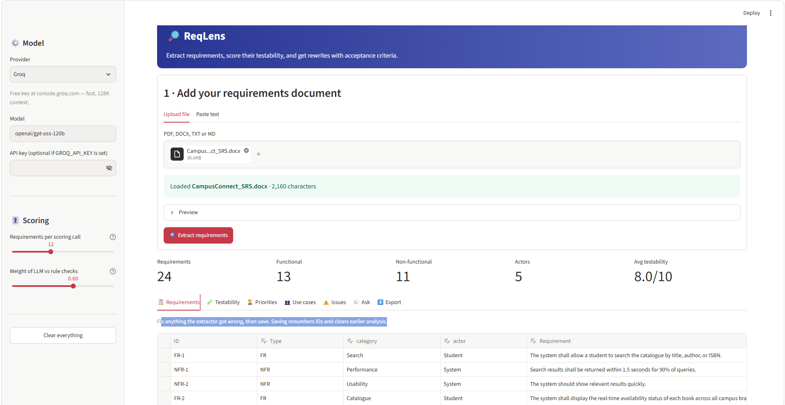
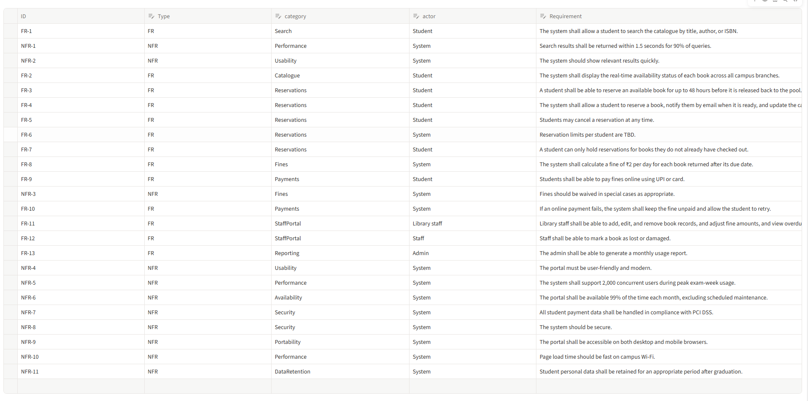
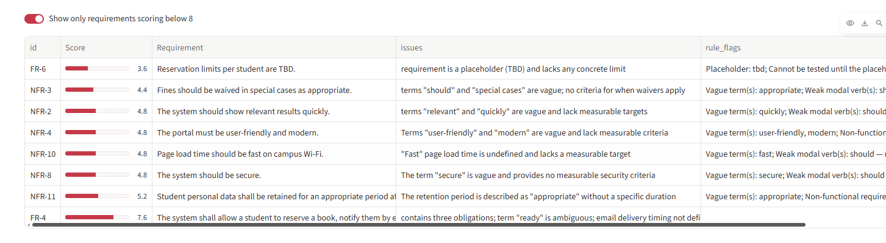

<div align="center">

# 🔎 ReqLens

### AI Requirements Reviewer with Testability Scoring

Upload a requirements document. Get every requirement extracted, scored for **how testable it is**, and rewritten into something a QA engineer could actually test.

[](https://www.python.org/)
[](https://streamlit.io/)
[](tests/test_core.py)
[](LICENSE)



</div>

---

## The problem

Most defects in software are traced back to bad requirements, not bad code. A requirement like
*"the system should be fast"* cannot be tested, cannot be signed off, and will be interpreted
differently by every person who reads it — but these slip into specifications constantly.

ReqLens reads a requirements document and tells you, requirement by requirement, **which ones
can't be tested and exactly why** — then proposes a version that can.

## What it does

| | |
|---|---|
| 📄 **Extraction** | Pulls every requirement out of a PDF / DOCX / TXT / MD into a table with IDs, FR/NFR type, category and actor. Fully editable before analysis. |
| 🧪 **Testability scoring** | Scores each requirement **0–10** across five ISO/IEC/IEEE 29148 quality characteristics: *unambiguous, verifiable, atomic, complete, consistent.* |
| ⚖️ **Hybrid judge** | Combines **deterministic rule checks** with an **LLM rubric**, then reports how often the two agree (raw agreement + Cohen's κ) as a built-in sanity check on the model. |
| ✍️ **Rewrites** | Every weak requirement gets a testable rewrite plus a Given/When/Then acceptance criterion. Accept a rewrite in one click and re-score it. |
| 🏆 **MoSCoW prioritisation** | Must / Should / Could / Won't, with business value, complexity and dependencies, plotted on a value-vs-complexity chart. |
| 👥 **Use-case diagram** | The LLM identifies actors and use cases; the Mermaid syntax is **generated in code**, so the diagram always renders. |
| ⚠️ **Document-level review** | Conflicts between requirements, missing areas, and the questions to take back to stakeholders. |
| 💬 **Grounded Q&A** | Ask questions in natural language; every answer cites requirement IDs like `[FR-3]` so you can verify it. |
| ⬇️ **Export** | Excel workbook, Markdown report, or CSV. |
| 🔌 **Provider-agnostic** | Groq, Google Gemini, or a fully local Ollama model — switched from the sidebar, no code change. |

## Screenshots

**Extraction** — requirements pulled into an editable table with IDs, types and actors



**Testability scoring** — every low-scoring requirement, with the specific reason it failed



> From the included sample document: the `TBD` placeholder scores **3.6**, vague requirements
> like *"should be secure"* and *"must be user-friendly and modern"* score **4.8**, and a
> requirement bundling three separate obligations scores **7.6** — correctly penalised for not
> being atomic while still being otherwise well-formed.

## How the testability score works

Each requirement is scored **0–2 on each of five criteria**, giving a mark out of 10. Two
independent judges run over every requirement:

| Criterion | Rule checks catch | The LLM judges |
|---|---|---|
| **Unambiguous** | vague terms (*fast, user-friendly, secure, intuitive*), weak modals (*should, may, could*), leading pronouns | wording open to more than one reading |
| **Verifiable** | NFRs with no number, unit or standard; placeholders; missing *shall/must* | whether a tester could write a pass/fail test from it alone |
| **Atomic** | multiple *shall*s, multiple sentences, > 45 words | several obligations bundled together |
| **Complete** | `TBD`/`TBC`, *etc.*, *as appropriate*, very short text | missing actor, conditions, inputs or limits |
| **Consistent** | — | contradictions with other requirements in the same document |

```
final score = w × (LLM score) + (1 − w) × (rule score)        # w = 0.6, adjustable in the UI
```

Because the rule layer is deterministic, it also acts as a **check on the model**: the app
reports how often the two judges agree on whether each criterion has a problem, plus Cohen's κ
(agreement corrected for chance). A sharp drop in agreement is a signal that the LLM is drifting
— being too lenient, or too harsh.

## Architecture

```
document ──► loaders ──► extract (LLM, chunked) ──► requirement list [FR-1, NFR-1, …]
                                                            │
         ┌──────────────┬──────────────┬───────────────┬────┴─────────┬───────────┐
         ▼              ▼              ▼               ▼              ▼           ▼
   rules.py       score (LLM,     prioritise      use cases        issues        Q&A
 (deterministic)    batched)        (MoSCoW)      → Mermaid    (conflicts,   (cites IDs)
         └──────┬───────┘                                       gaps, Qs)
                ▼
   final score  +  rule-vs-LLM agreement / κ
```

**No RAG, by design.** The document is read once and turned into a compact structured list;
every later step operates on that list rather than re-sending the document. For requirements
work this beats retrieval — ambiguity and consistency checks need to see *all* the requirements
at once, not the four chunks a vector search happened to return. It also removes `faiss`,
`torch` and `transformers` from the dependency tree entirely.

```
req-analyzer/
├── app.py                    # Streamlit UI
├── core/
│   ├── config.py             # providers, models, tuning knobs
│   ├── llm.py                # OpenAI-compatible client, JSON repair, rate-limit backoff
│   ├── loaders.py            # PDF/DOCX/TXT reading, paragraph-safe chunking
│   ├── prompts.py            # every prompt in one place
│   ├── rules.py              # deterministic testability checks
│   ├── analysis.py           # pipeline + Pydantic schemas
│   ├── diagram.py            # Mermaid generation
│   └── export.py             # tables, Excel, Markdown
├── samples/                  # two demo documents with deliberately flawed requirements
└── tests/test_core.py        # 14 offline tests using a fake LLM — no API key needed
```

## Quick start

```bash
git clone https://github.com/<your-username>/reqlens.git
cd reqlens

python -m venv .venv
# Windows:        .venv\Scripts\activate
# macOS / Linux:  source .venv/bin/activate

pip install -r requirements.txt
cp .env.example .env          # paste one free API key into it
streamlit run app.py
```

Then: **Paste text → Load sample SRS → Extract requirements → Testability → Score testability.**

### Getting a free API key

| Provider | Where | Default model | Notes |
|---|---|---|---|
| **Groq** (recommended) | [console.groq.com/keys](https://console.groq.com/keys) | `openai/gpt-oss-120b` | Free, no card required |
| **Gemini** | [aistudio.google.com/apikey](https://aistudio.google.com/apikey) | `gemini-2.5-flash` | Free tier may use prompts for training — avoid confidential documents |
| **Ollama** | — | `llama3.1` | Runs entirely offline on your machine |

> **If you get a 404 "model does not exist":** providers retire model names periodically.
> Check the provider's current model list and paste the new name into the **Model** box in the
> sidebar — no code change needed.

## Tests

```bash
python -m pytest -q      # 14 tests, no API key required
```

The suite uses a fake LLM that returns canned (and deliberately malformed) JSON, so it covers
the rule engine, type coercion, de-duplication, the re-ask path when the model skips a
requirement, Mermaid generation and the exporters — all offline and deterministic.

## Deploying free on Streamlit Community Cloud

1. Push this repo to GitHub (`.env` is git-ignored — never commit your key).
2. Go to [share.streamlit.io](https://share.streamlit.io) → **New app** → select the repo, main file `app.py`.
3. **Advanced settings → Secrets**, add:
   ```toml
   GROQ_API_KEY = "gsk_your_key_here"
   ```

## Roadmap

- [ ] Version diff — upload v1 and v2 and see which requirements were added, changed or removed
- [ ] Export acceptance criteria as Gherkin `.feature` files
- [ ] Push low-scoring requirements to GitHub Issues or Jira
- [ ] Benchmark the scorer against a hand-labelled set of requirements
- [ ] Domain profiles (e.g. IEC 62304 traceability checks for medical-device software)

## Acknowledgements

The idea was inspired by [req-analyzer-ai](https://github.com/nouman-071/req-analyzer-ai).
ReqLens is an independent rebuild with a different architecture — structured JSON instead of
parsed prose, a modular tested core instead of a single script, no RAG, provider-agnostic model
access, and the hybrid testability-scoring engine as its main contribution.

## Author

**Priyanshu Sharma** — M.Tech Bioengineering, IISc Bangalore

## License

[MIT](LICENSE)
